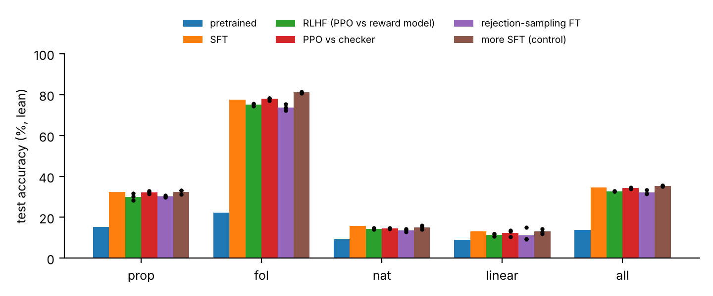
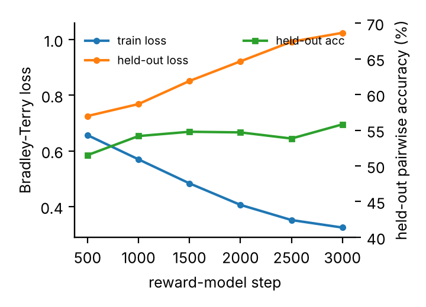
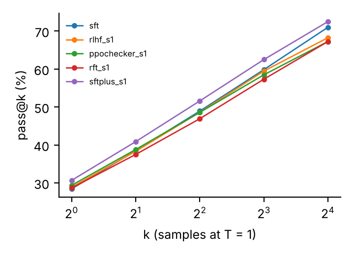
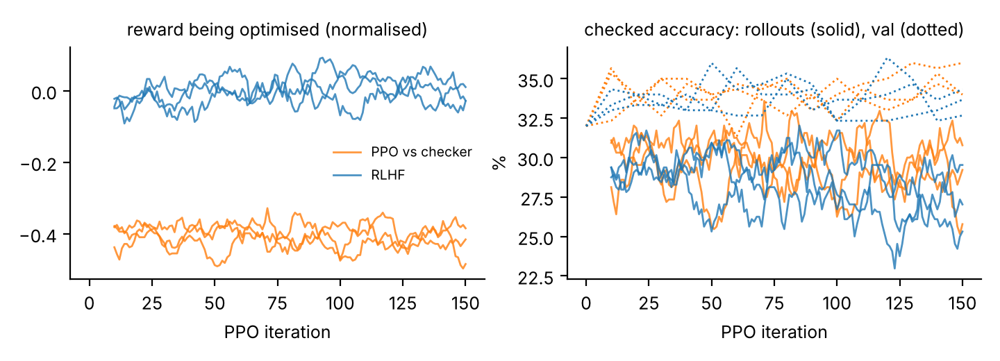

## Summary

**What I changed.** I trained a 0.8M-parameter character-level GPT from scratch on Lean 4 only: propositional and
first-order proofs, `Nat` arithmetic and linear equations. There is no natural language and no safety training anywhere
in the pipeline. I then post-trained one supervised fine-tuned (SFT) checkpoint in four ways, with three seeds each:

* **RLHF:** PPO against a Bradley-Terry reward model trained on 25,622 checker-labelled comparisons (another 1,161
  were held out);
* **PPO against the proof checker** itself;
* **rejection-sampling fine-tuning (RFT);**
* **a control** of 600 more SFT steps.

Each of the three sampling arms drew 9,600 policy samples.

**How I measured it.** Greedy accuracy on 2,000 held-out test problems. The split hashes a canonical form of each
problem, so renamed copies of test problems stay out of training. Every finished answer was compiled with Lean 4. Each
arm is compared with SFT on the same problems, pooling the seeds, with paired bootstrap 95% confidence intervals.
I also measured:

* the reward model on held-out comparisons;
* the reward model's score against checked accuracy during PPO;
* pass@16;
* validation results against test results.

**What I learned.**

* **No method beat SFT significantly.** SFT scores 34.7%. Against it, RLHF lost 1.9 points [−3.2, −0.7], PPO
  against the checker 0.4 [−1.5, +0.6], and RFT 2.5 [−3.8, −1.2]. More SFT gained 0.7 [−0.4, +1.9]. Every RL and RFT
  arm finished 1.2 to 3.2 points below more SFT.
* **The reward model generalised poorly.** It ranked 85.1% of its training pairs correctly but only 55.8% of held-out
  pairs. In the last 30 PPO iterations, RLHF's samples scored 0.105 standard deviations higher than SFT's on the
  reward model, and 1.5 points lower on the checker, on the same prompts. RLHF raised the reward without raising
  accuracy.
* **The 300-problem validation split gave the wrong sign.** 11 of 12 post-trained runs beat SFT on validation, yet all 9
  RL and RFT runs were below SFT on test. Most of this comes from one low draw: SFT solved 3 of the 75 validation
  linear problems.
* **The checker held up.** It never accepted an answer that Lean rejected: 0 of 28,000 greedy test answers and 0 of
  44,800 sampled answers.

## 1. The model and the data

A problem is a Lean 4 declaration cut in two: the model sees the header and writes the rest, and the whole declaration
must compile.

| domain | the model sees | and writes |
|-------|--------------------------------------------------|------------------------------|
| prop | `example (p q s : Prop) : p ∧ (¬p ∧ ¬q) ∧ s → ¬p :=` | `fun h0 => h0.2.1.1` |
| fol | `example (α : Type) (P R : α → Prop) (q : Prop) : (∃ x, P x) → (∀ x, P x → q ∧ R x) → ∃ x, q ∧ R x :=` | `fun ⟨x, h0⟩ h1 => ⟨x, h1 x h0⟩` |
| nat | `example : (10 - 10 * 6) % 15 + 7 =` | `7 := by decide` |
| linear | `example (x : Int) (h : 7 * x - 14 = x + 10) : x =` | `4 := by omega` |

* **Model.** A character-level GPT-2-style transformer: 4 layers, 4 heads, width 128, a 256-token context. It has
  835,840 parameters, or 803,072 excluding position embeddings.
* **Domains.** In `nat` and `linear` the answer is a single integer, so a guess can be right.
  * `nat` subtraction truncates at 0, as in Lean.
  * The constant answer `0 := by decide` is correct on 10.0% of `nat` test problems.
  * The best constant `linear` answer is correct on 4.0%.
* **Checkers.** Each domain has a fast Python checker for its fragment of Lean 4. A checker may reject a proof Lean
  accepts, never the reverse. The tests fuzz the checkers against Lean 4.34.

## 2. The training pipeline

| stage | data | settings | time per run |
|--------------|------------------------------------|----------------------------------------------------|-----------:|
| pretraining | 160k declarations, 14M tokens | 5,000 steps × 32 | ≈1,020 s |
| SFT | 80k shortest reference proofs | 3,000 steps × 64 | 1,214 s |
| reward model | 48,000 SFT samples plus each prompt's reference → 26,783 pairs | Bradley-Terry, 3,000 steps | 2,933 s |
| **RLHF** | 150 × 64 = 9,600 rollouts | PPO on RM score − 0.1·KL; lr 5e-6; critic from RM | 1,002 s |
| **PPO vs checker** | the same | PPO on ±1 from the checker − 0.1·KL; critic from SFT | 1,003 s |
| **RFT** | 2 × 1,200 prompts × 4 = 9,600 | shortest verified answer kept; 3 epochs per round | 200 s |
| **more SFT** | 600 × 64 references from a new 80k sample (34% repeat SFT's problems) | lr re-warmed to 1e-4 | 524 s |

**Labelling.** The checker ranks each pair in place of human raters. A correct proof beats an incorrect one, and of
two correct proofs the shorter wins. 98% of the pairs set a prompt's reference proof (chosen) against an SFT sample.
Only 5 of the 26,783 labels would flip if Lean replaced the checker, so the labels are essentially noise-free: any gap
between the reward model and the checker is the reward model's own error.

**Iterates.** Every run keeps its final iterate.

**Times.** These are wall-clock means from the run log. The post-training arms ran two at a time on 2 threads each;
the earlier stages ran alone on 4.

## 3. How it was measured

* **Split.** Problems are split train/val/test (90/5/5) by a hash of a canonical form. The canonical form renames
  atoms, and in `nat` and `linear` it also identifies commuted operands and swapped equation sides. Test has 2,000
  problems (500 per domain); validation has 300.
* **Metric.** Greedy pass@1. An answer counts only if it is finished and Lean 4 compiles it.
* **Statistics.** All checkpoints answer the same problems, so differences are paired.
  * For an arm, each problem's correctness is averaged over the arm's three seeds.
  * The paired bootstrap 95% CI (stratified by domain) and the paired z-test p cover problem sampling only.
  * Seed-to-seed variation is shown directly: the difference from SFT for each seed, and exact McNemar tests for
    single seeds.

## 4. Results

### 4.1 Test accuracy

Lean-verified test accuracy (%). Each arm shows the mean over its 3 seeds, and "all" adds the SD over seeds. The pooled
difference from SFT is Δ.

| checkpoint | prop | fol | nat | linear | all | Δ vs SFT [95% CI] | p | Δ per seed |
|----------------|------:|------:|------:|------:|-----------:|------------------:|--------:|-------:|
| pretrained | 15.2 | 22.4 | 9.2 | 9.0 | 14.0 | | | |
| SFT | 32.4 | 77.6 | 15.8 | 13.0 | 34.7 | | | |
| RLHF | 30.1 | 75.1 | 14.4 | 11.5 | 32.8 ± 0.2 | −1.9 [−3.2, −0.7] | 0.0029 | −2.10 / −1.70 / −2.00 |
| PPO vs checker | 32.3 | 77.9 | 14.5 | 12.4 | 34.3 ± 0.4 | −0.4 [−1.5, +0.6] | 0.43 | −0.15 / −0.85 / −0.25 |
| RFT | 30.2 | 73.8 | 13.6 | 11.3 | 32.2 ± 1.1 | −2.5 [−3.8, −1.2] | 0.00015 | −1.20 / −3.10 / −3.15 |
| more SFT | 32.5 | 81.1 | 15.1 | 13.0 | 35.4 ± 0.2 | +0.7 [−0.4, +1.9] | 0.21 | +0.45 / +0.90 / +0.85 |

* **RLHF.** All three seeds are worse than SFT (McNemar p = 0.008, 0.024, 0.011), but none survives Holm correction
  over the 12 per-seed tests.
* **PPO against the checker.** No seed differs from SFT (p ≥ 0.22).
* **RFT.** Seeds 2 and 3 are significantly worse (p = 0.0001 and 0.0002). They are the only per-seed tests below 0.05
  after Holm correction. Seed 1 is not significant (p = 0.16).
* **More SFT.** The gain is in fol only: +3.5 [+1.3, +5.6], p = 0.0013.

| arms compared (pooled seeds) | Δ [95% CI] | p | fol Δ |
|------------------------------|-------------------:|---------:|-------:|
| RLHF − more SFT | −2.7 [−3.9, −1.5] | 6×10⁻⁶ | −5.9 |
| PPO vs checker − more SFT | −1.2 [−2.1, −0.2] | 0.016 | −3.1 |
| RFT − more SFT | −3.2 [−4.3, −2.1] | 7×10⁻⁹ | −7.3 |
| RFT − PPO vs checker | −2.1 [−3.0, −1.2] | 2×10⁻⁵ | −4.1 |
| RLHF − PPO vs checker | −1.5 [−2.5, −0.5] | 0.0026 | −2.8 |
| RLHF − RFT | +0.6 [−0.5, +1.6] | 0.29 | +1.3 |

In all 9 seed pairings of each RL or RFT arm with more SFT, the RL or RFT seed scores lower.

### 4.2 What changed in the answers

* **Every arm loses answers SFT was unsure of, the control included.**
  * Summed over seeds, RLHF lost 405 SFT-solved problems and gained 289.
  * On the 128 problems where SFT's correct answer had probability below 0.25, the arms lost on average 38% (PPO vs
    checker) to 61% (RFT) of them, and 34% to 65% per seed. More SFT lost 39% to 45%.
  * On the 307 problems where that probability was at least 0.75, the arms lost at most 3% on average, and at most
    4.6% for a single seed.
* **The sampling arms answer 0 more often in `nat`.**
  * SFT answers 0 on 48 of 500 `nat` problems. Eight of the nine RL and RFT seeds answer 0 more often (the nine range
    from 43 to 159), while more SFT answers 0 on 32 to 39.
  * Zero is the most common value (50 of 500 test problems). For the checker-rewarded arms, a sampled 0 is therefore
    often right and gets reinforced. In RFT seed 1's first round, 16% of the kept `nat` answers were 0, against 7% of
    the true values on those prompts. This is a likely explanation, not a measured one.
  * On the 450 `nat` problems whose value is not 0, SFT solves 50 and the RL and RFT seeds 30 to 44.
  * `linear` shows no such shift.
* **RFT's answers became less varied.** In prop, RFT gives 154 to 173 distinct answers out of 500, against SFT's 223.
  On one fol problem, all three RFT seeds turned SFT's correct `fun x h0 => h0 x` into
  `fun x h0 h1 => h0 x h1.1 h1.2`. That is a reordering of `fun h0 x h1 => h0 x h1.1 h1.2`, a frequent training
  reference (142 of 20,000 fol references).
* **On the fol problems RLHF lost, the reward model usually preferred RLHF's wrong answer.** It scored the wrong answer
  above SFT's correct one in 66% of cases (73 of 110 problem-seed pairs). Over all domains the figure is 54%. On fol
  losses the comparable figures are 55% for PPO vs checker and 49% for RFT.

### 4.3 Validation versus test

| | SFT | RLHF | PPO vs checker | RFT | more SFT |
|----------------------|------:|-----------------:|-----------------:|-----------------:|-----------------:|
| val, seeds 1 / 2 / 3 (%) | 32.0 | 33.7 / 32.7 / 34.3 | 34.0 / 36.0 / 34.0 | 34.3 / 32.0 / 32.7 | 35.0 / 36.7 / 37.0 |
| Δ vs SFT, val / test | | +1.6 / −1.9 | +2.7 / −0.4 | +1.0 / −2.5 | +4.2 / +0.7 |

* **The splits disagree.** On validation, 11 of 12 post-trained runs beat SFT and RFT seed 2 tied it (96 of 300). All 9
  RL and RFT runs were at or above SFT on validation and below it on test.
* **No single validation difference is significant after Holm correction, but together they are.** On average, the arms
  gain 3.4 points more on validation than on test. Under 20,000 random within-domain re-splits of the val and test
  problems, this excess has mean 0 and SD 1.4 (one-sided p = 0.009).
* **Most of the excess comes from SFT's linear validation score.** SFT solved 3 of 75 (4.0%) validation linear
  problems, against 13.0% on test (Fisher p = 0.021).
  * Linear contributes 2.4 of the 3.4 points.
  * Recomputed on the other three domains alone, the excess is 1.3 points (one-sided p = 0.21).
  * This breakdown was post hoc. All 12 comparisons share SFT's one low draw.
* **Selecting an iterate on validation would probably have overstated the gain.** 89 of 90 validation evaluations
  during PPO were above SFT. The best of 15 iterates per run would have shown +3.0 to +4.3 points, close to the first
  run's +4.6 points, which did not transfer. Intermediate iterates were not saved, so this could not be checked on test.

### 4.4 The reward model and reward hacking

Reward-model scores below are in units of SD: the standard deviation (2.74) of its scores on SFT samples for held-out
prompts, which PPO uses to normalise the reward.

| reward model | pairs | prompts | pairwise accuracy | Bradley-Terry loss |
|------------|-------:|-------:|----------------------------------------------------------:|-----------:|
| training | 25,622 | 5,213 | 85.1% | 0.313 |
| held out | 1,161 | 251 | 55.8% [51.2, 60.6] (prop 58.1, fol 64.2, nat 53.4, linear 52.7) | 1.024 |

| reward-model training (section 4.4) | sampled pass@k, seed 1 of each arm (section 4.6) |
|:-:|:-:|
|  |  |

* **It overfitted.**
  * Its training loss fell from 0.657 to 0.324, while held-out loss rose from 0.725 at step 500 to 1.024 at step
    3,000. Held-out loss was worse than a constant predictor's (ln 2 = 0.693) at every evaluation.
  * Because 98% of the pairs set a prompt's reference proof against an SFT sample, the model could fit its training
    prompts by recognising their references. This was not tested.
* **It judged correctness only weakly.** Its AUC for correctness on SFT's test answers is 0.619 [0.594, 0.644], and
  only 0.519 in linear.
* **RLHF raised the reward without raising accuracy.**
  * On the same prompts as SFT, RLHF's reward-model excess rose from +0.019 SD (iterations 1–30) to +0.105 SD
    (iterations 121–150).
  * Its checker accuracy stayed 1.2 to 1.5 points below SFT's throughout. It was already −1.2 ± 1.0 in iterations 1–30.
  * In iterations 121–150, against PPO vs checker on identical prompts, RLHF scored 0.087 SD more on the reward model
    and 2.0 points less on the checker (accuracy p = 0.001).
  * This is mild compared with an earlier configuration of the first project (a weaker reward model and a looser KL
    penalty), where checked accuracy fell from 41% to 8%.
* **On test, the reward model's ranking of the post-SFT checkpoints is unrelated to Lean's.**
  * RLHF's answers score highest, 0.097 SD [0.077, 0.118] above SFT's, at 1.9 points lower accuracy.
  * Across the 13 post-pretraining checkpoints, reward-model score and accuracy correlate at −0.20 (p = 0.51).
  * Example: SFT's correct `19 + (8 + 5) = 32` became 33 in two RLHF seeds and in four checkpoints of other arms,
    including one more-SFT seed. The reward model scored 33 1.65 SD higher.

### 4.5 Training dynamics

* **Raw rollout accuracy mixes two things.** The figure below shows rollout accuracy, which changes both with the
  policy and with the difficulty of the prompts drawn.
  * Prompts are drawn without repeating a canonical form, so frequent forms are probably used up first.
  * SFT itself, on the same prompts, falls from 30.6% (iterations 1–30) to 28.7% (iterations 121–150).
* **Policies compared with SFT on the same prompts.** The table below does this (± is a 95% half-width).

| 3 seeds pooled | RLHF, it. 1–30 | RLHF, it. 121–150 | PPO vs checker, 1–30 | PPO vs checker, 121–150 |
|----------------------------|---------------:|---------------:|---------------:|---------------:|
| accuracy − SFT, points | −1.2 ± 1.0 | −1.5 ± 0.9 | −0.6 ± 0.9 | +0.5 ± 1.1 |
| reward-model score − SFT, SD | +0.019 ± 0.017 | +0.105 ± 0.020 | +0.022 ± 0.018 | +0.018 ± 0.018 |
| KL to SFT, nats per answer | 0.069 | 0.335 | 0.051 | 0.117 |

* **PPO against the checker did not measurably improve its own objective.** Relative to SFT, its accuracy changed by
  +1.0 ± 1.4 points. Answer length stayed between 24 and 25.5 tokens in both PPO arms.
* **RFT trained mostly on what SFT already did.**
  * In seed 1's first round (regenerated exactly), 97% of the 609 kept answers are the reference proof, and 67% come
    from prompts SFT already solves greedily.
  * In round 2, the policy matched SFT's per-sample accuracy but solved 4.2 ± 2.1 points fewer prompts in 4 tries.
* **SFT was undertrained.**
  * Its validation loss was still falling at step 3,000 (0.1142 to 0.1116 over the last 500 steps), and more SFT cut
    it by a further 4.3%.
  * This may explain why the control did best.
  * The control also trained on 38,400 reference examples, four times the sampling arms' 9,600 samples.

### 4.6 Sampled pass@k

400 test problems, 16 samples at temperature 1, judged by the checker (Lean agreed on every accepted sample).
"Coverage" means at least 1 of the 16 samples is correct.

| seed 1 | greedy | pass@1 | pass@16 | Δ pass@1 [95% CI] | Δ pass@16 [95% CI] | coverage gained / lost |
|--------------|------:|------:|-------:|-----------------:|-----------------:|----------:|
| SFT | 36.5 | 28.5 | 71.0 | | | |
| RLHF | 34.0 | 28.9 | 68.2 | +0.4 [−1.0, +1.9] | −2.8 [−7.0, +1.2] | 32 / 43 |
| PPO vs checker | 37.5 | 29.4 | 67.2 | +0.9 [−0.4, +2.2] | −3.8 [−8.2, +0.8] | 33 / 48 |
| RFT | 33.8 | 28.7 | 67.2 | +0.2 [−1.3, +1.8] | −3.8 [−8.2, +0.5] | 33 / 48 |
| more SFT | 38.8 | 30.7 | 72.5 | +2.2 [+1.0, +3.4] | +1.5 [−2.8, +6.0] | 44 / 38 |

* **RL and RFT.** These arms leave pass@1 unchanged. Their pass@16 point estimates are 2.8 to 3.8 points lower, none
  significantly. As a noise reference, two fresh draws of SFT's own 16 samples moved its pass@16 by −2.2 and 0.0
  points.
* **More SFT.** It is the only arm with a significant change, +2.2 points of pass@1, and it keeps its coverage.

### 4.7 Lean audit and split integrity

* **Checker against Lean.**
  * The 28,000 greedy test answers contain 8,174 distinct finished declarations. The checker accepted none that Lean
    rejected.
  * It rejected 2 declarations (4 answers) that Lean accepted, which is the safe direction. One is a `trivial` that
    Lean closes by contradiction from the hypothesis `¬True`; the other is a `nat` answer with an extra space.
  * Recompiling in shuffled order changed 0 verdicts.
  * The sampled answers comprise the 32,000 behind the pass@k table, regenerated with per-problem counts identical to
    the evaluation, plus 12,800 from two extra SFT draws. The checker accepted none of these 44,800 that Lean rejected.
* **No exact leakage.** No regenerated training stream contains a test split key or test prompt.
* **Near-duplicates.** Looser near-duplicates exist, and every arm inherits them from SFT.
  * 102 of 500 prop test problems match an SFT training problem up to renaming, commutativity and premise order (129
    match a pretraining document).
  * 69 fol test problems share a training problem's shape.
  * Every linear test problem's reduced equation a·x = b occurs in training: only 369 distinct (a, b) pairs appear
    among 20k training problems.
  * Pairing does not remove an effect of these if arms differ in how much near-duplicate data they see. More SFT,
    which trained on new references, gained no more on its new near-duplicates than elsewhere.

### 4.8 The first run

An earlier version of this project ran before the replication. Its code and records were lost with the machine it ran
on, except its README, which is the source of these numbers. It used different generators and checker verdicts only.
Accuracy on 1,200 held-out test problems (300 per domain), greedy decoding:

| checkpoint | prop | fol | nat | linear | all |
|------------------------------------------|------:|------:|------:|------:|------:|
| pretrained | 29.3 | 54.0 | 16.0 | 8.0 | 26.8 |
| SFT | 47.0 | 67.7 | 21.7 | 15.7 | 38.0 |
| **RLHF**, iterate chosen on val (90 of 150) | 46.7 | 67.0 | 21.0 | 20.0 | **38.7** |
| RLHF, last iterate | 44.7 | 65.3 | 20.0 | 17.0 | 36.7 |
| PPO against the checker, iterate chosen on val (100 of 150) | 47.0 | 67.3 | 24.0 | 14.3 | 38.2 |

* **RLHF did not measurably improve on SFT.** The +0.7 points is well within sampling error: one accuracy on 1,200
  problems has a standard error of about 1.4 points. The last iterate is worse than SFT. The reward model, trained on
  22,009 checker-labelled comparisons, ranked 57% of held-out pairs correctly.
* **A weaker reward model with a looser KL penalty led to reward hacking.** In that configuration the reward-model
  score rose while checked accuracy fell from 41% to 8%. The replication uses the settings that were stable (lr 5e-6,
  KL coefficient 0.1).
* **The validation-selected iterate did not transfer.** It was the best of 16 evaluations (counting iteration 0) and
  4.6 points above SFT on validation, but not on test.
* **The first run's PPO learned a synthetic reward.** With a reward for short answers, the share of rewarded answers
  went from 30% to 97% in 30 iterations. This check was not repeated with the rebuilt code.

## 5. What I learned

1. **The reward model is the most likely limit on RLHF.**
   * It was trained on 25,622 checker labels, essentially noise-free, and still reached only 55.8% on new prompts.
     RLHF raised its score without raising checked accuracy.
   * It is not the only limit. PPO with the exact checker reward also failed to beat SFT, and the comparison between
     the two PPO arms is confounded by how their critics were initialised.
   * Both diagnostics are cheap: the reward model's held-out accuracy, and the reward against ground truth on the
     baseline's prompts.
2. **The control set the bar the RL arms failed to reach.** SFT had not converged, and every RL and RFT arm trails 600
   more steps of it. Those steps were about 11 times RFT's optimiser steps and about half a PPO run's wall-clock time.
3. **A verifier reward also reinforces correct guesses.** In `nat`, the checker-rewarded arms (PPO vs checker and RFT)
   and two of the three RLHF seeds answered 0 more often; `linear` shows no such shift. RFT mostly reinforced answers
   SFT already gave.
4. **Small evaluations need paired tests, seeds and a large test set.**
   * One low SFT validation score made 11 of 12 runs look better. In the first run, the best of 15 iterates did the
     same.
   * Seeds matter as much as problems. RFT's difference from SFT has p = 0.00015 over problems, but its three seeds
     range from −1.2 to −3.15 points, and a t-test treating seeds as the unit gives p = 0.06.
5. **Check the checker against Lean.** Review and fuzzing found two holes in the old checkers. After the fixes, the
   checker accepted no finished answer that Lean rejected: none of the 28,000 greedy test answers and none of the
   44,800 sampled answers.

## 6. Limitations

* **Scale and tuning.**
  * 0.8M parameters, synthetic domains, a 4-core CPU. Nothing here tests larger models.
  * No hyperparameters were tuned for the replication, including RFT's. PPO's learning rate and KL coefficient were
    carried over from the first project, where they were chosen after a collapse.
* **Seeds.** Three per arm. RFT's seeds differ by 1.95 points, and its result rests on two of them.
* **Critic initialisation.** RLHF's critic starts from the reward model; the checker arm's starts from SFT with a zero
  head. A comparison of the two PPO arms therefore mixes the effect of the reward with the effect of the critic.
* **Budgets.** The reward model used 48,000 SFT samples outside the 9,600-sample budget. More SFT ran about 11 times
  RFT's optimiser steps on 38,400 reference examples. SFT itself was not converged.
* **Preferences.** Checker labels test whether the reward model generalises from clean labels. They say nothing about
  human disagreement. Most comparisons set the reference proof against a sample.
* **Scope.**
  * pass@k covers seed 1 and 400 problems.
  * The linear validation analysis was post hoc.
  * The reward model was first evaluated at step 500.
  * `nat` scores are within 6 points of the 10% constant-answer floor. `linear` scores (11–13%) are low, though about
    3 times their 4% floor.
  * The first run's numbers cannot be checked.
* **Scripts.** `stats.py` and `analyze.py` produce the main table and the figures. Everything else came from the one-off
  scripts in `analysis/`, some of which read intermediate files not in the repository:
  * the per-problem analyses and the reward-model rescoring;
  * the matched-prompt baselines and the permutation test;
  * the pass@k comparisons, the Lean audit and the split checks.

## Reproducing

Code and tests are at <https://github.com/rbahl1/nanogpt>.

* `LEAN=/path/to/lean ./run_experiment.sh out results` runs everything in a few hours on 4 cores. Pretraining, SFT and
  the reward model resume exactly after an interruption; an interrupted PPO or RFT run restarts from the beginning.
* `python analyze.py --out out --results results` writes `results/summary.md` and the figures.
* `docs/build_report.sh` builds this PDF.
